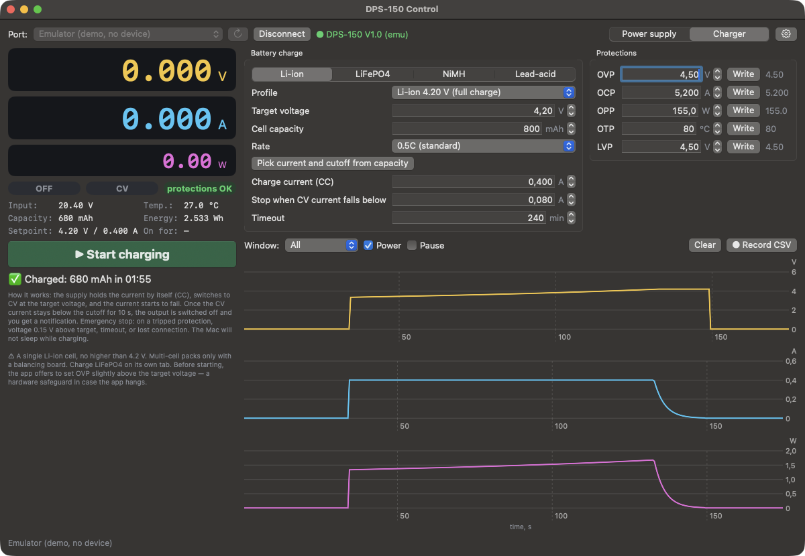
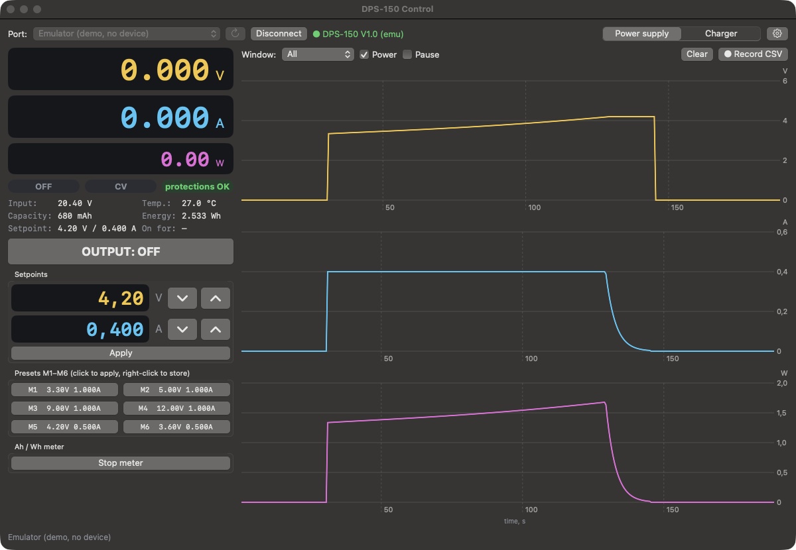
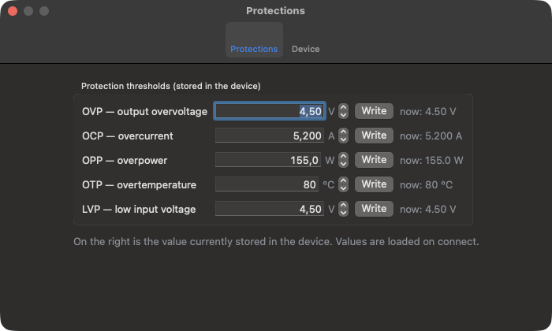

# DPS-150 Control

[](../../actions/workflows/ci.yml)
[](LICENSE)

A native macOS app for the **FNIRSI DPS-150** bench power supply: live readings,
setpoints, presets, protections, plots, CSV logging, and battery charging with
automatic cutoff — Li-ion, LiFePO4, NiMH and 6/12 V lead-acid.

SwiftUI, no third-party dependencies, macOS 14+. English and Russian UI
([README по-русски](README.ru.md)).



| Power supply mode | Settings |
| --- | --- |
|  |  |

> **Not affiliated with FNIRSI.** The serial protocol comes from the
> reverse-engineering work of [cho45/fnirsi-dps-150](https://github.com/cho45/fnirsi-dps-150)
> and is documented in [docs/PROTOCOL.md](docs/PROTOCOL.md).

## Install

- **Mac App Store** — once the first release is approved.
- **GitHub Releases** — download `DPS-150-Control-x.y.z.zip` from the
  [Releases](../../releases) page and move the app to `/Applications`. This build
  checks GitHub for a new release on launch (and via **Check for Updates…**), shows
  the release notes and can download and install the update itself. It makes one
  request to `api.github.com` per launch and sends nothing else.
- **From source** — see below.

## Connecting

Plug the DPS-150 into the Mac through its **micro-USB data port** (the Type-C port
is power only). The device shows up as `/dev/cu.usbmodem…` and is marked with ★ in
the port list. No driver is needed.

No hardware at hand? Pick **Emulator (demo, no device)** in the port list: it
simulates the supply with a Li-ion cell on the output (time runs 60× faster), so you
can try everything, including a full charge.

## Features

- **Two modes**, switched in the top bar: *Power supply* and *Charger*.
- **Readings:** large V / A / W, CC/CV mode, protection state, input voltage,
  temperature, output-on time.
- **Setpoints:** big V and I fields with ▼▲ buttons (step 0.1, with ⌥ 0.01, hold to
  repeat), or type a value and press Enter. Changes made with the knob on the device
  are mirrored in the window.
- **Output:** button or ⌘↩.
- **Presets M1–M6:** click applies a preset, right-click stores the current setpoints.
- **Ah/Wh meter:** the device's built-in counter, can be started and stopped.
- **Plot:** V, I and P over a window from 30 s to "all". Pause, clear, export (⌘S),
  and continuous CSV recording.
- **Battery charging:**
  - a tab per chemistry, each with its own profiles, rates, cutoff and warnings:
    Li-ion (4.20 / 4.10 / 3.80 V), LiFePO4 (3.60 / 3.45 V), lead-acid (6 V, 12 V,
    12 V gel) and NiMH (1–12 cells);
  - picks the charge current and the cutoff from the battery capacity;
  - Li-ion, LiFePO4, lead-acid: CC/CV, the output is switched off once the CV
    current stays below the cutoff for 10 s;
  - NiMH: standard slow charge at 0.1C, stopped at 150% of capacity or by the
    timer (no −ΔV fast charging);
  - lead-acid and NiMH are **experimental** (and marked so in the app): tested only in the emulator, see
    [Testing status](#testing-status);
  - emergency stop on a tripped protection, voltage 0.15 V above target, timeout,
    lost connection, or if no current ever flows;
  - offers to set OVP and OCP slightly above the target voltage and charge current
    as a hardware safeguard, and to restore the previous values when you switch
    back to power supply mode;
  - macOS notification with sound when done; the Mac does not sleep while charging.
- **Protections:** OVP, OCP, OPP, OTP, LVP — read and write, on the charger screen
  and in Settings (⌘,).
- **Device** (in Settings): model and versions, output limits, brightness, volume.

## ⚠ Safety

This app switches a power supply that may have lithium cells attached. Charging
stops are implemented **in software**: if the app or the Mac hangs, only the
device's own OVP/OCP protect the cell — set them before charging. Check the cell
chemistry tab and the profile (the wrong one overcharges the battery), never leave a charging cell unattended,
and use the app at your own risk. Lead-acid and NiMH charging has so far been
tested only against the emulator. There is no warranty (see the license).

## Testing status

| What | Status |
| --- | --- |
| Connection, readings, setpoints, OVP write | Verified on a real DPS-150 (firmware V1.2) |
| Li-ion charging | Full cycle verified on a real DPS-150 with a real cell |
| LiFePO4 charging | Same CC/CV code path as Li-ion; verified against the emulator only |
| **Lead-acid charging** | **Emulator only — never tested on a real battery** |
| **NiMH charging** | **Emulator only — never tested on a real battery** |

The emulator models a single Li-ion cell. For lead-acid and NiMH this means that only
the user interface and the stop logic (capacity limit, timer, emergency stops) have
been exercised — not the behaviour of a real battery of that chemistry. The voltages,
currents and cutoffs for these two chemistries come from common charging
recommendations and have not been validated in practice. If you try them on a real
battery, stay next to it for the whole charge, check the battery's datasheet first,
and please report the result in an issue.

## Building from source

Requires macOS 14+ and Xcode or the Command Line Tools.

```bash
swift run DPS150Control --demo   # run with the emulator
swift run DPS150Control          # run with a real device
swift test                       # ~25 s: protocol, client and charging against the emulator
./build_app.sh --install         # dist/DPS-150 Control.app → /Applications
```

`swift run` always shows the Russian (source-language) UI; translations are picked
up only in the built `.app`.

`SANDBOX=1 ./build_app.sh` produces the same sandboxed build that goes to the App
Store — handy for checking that everything still works inside the sandbox.

## Project layout

```
Sources/DPS150Kit/Protocol.swift   frames, registers, incremental parser, DeviceState
Sources/DPS150Kit/Device.swift     serial client: reader thread + write queue
Sources/DPS150Kit/Fake.swift       DPS-150 emulator with a Li-ion cell model (demo and tests)
Sources/DPS150Kit/Charge.swift     CC/CV charge controller with auto cutoff
Sources/DPS150Control/             the app: Model.swift (state), Views.swift (UI)
Resources/*.lproj                  localizations (keys are the Russian source strings)
Tests/                             protocol, client and charging against the emulator
docs/PROTOCOL.md                   protocol reference (in Russian)
```

## Troubleshooting

- **"No data from device…"** — check that the cable is in the micro-USB port, not
  the Type-C power port, and that no other program holds the port
  (`lsof | grep usbmodem`).
- **Charging does not start, LVP is shown** — the supply has no input power on
  Type-C and is being back-fed from the cell.
- **The built app does not open** — run
  `dist/DPS-150\ Control.app/Contents/MacOS/DPS-150\ Control` from a terminal to see
  the error.

## Contributing

Issues and pull requests are welcome; for anything else write to dev@pazyuk.com. Changes to `ChargeController` or to the output
logic must be checked in `--demo` and with `swift test`; the emergency stops must not
be weakened. Every new UI string needs an entry in `Resources/en.lproj/Localizable.strings`.

## License

Copyright © 2026 Alexey Pazyuk <dev@pazyuk.com>.

This program is free software: you can redistribute it and/or modify it under the
terms of the GNU General Public License as published by the Free Software
Foundation, either version 3 of the License, or (at your option) any later version.
It is distributed WITHOUT ANY WARRANTY; see [LICENSE](LICENSE) for details.
