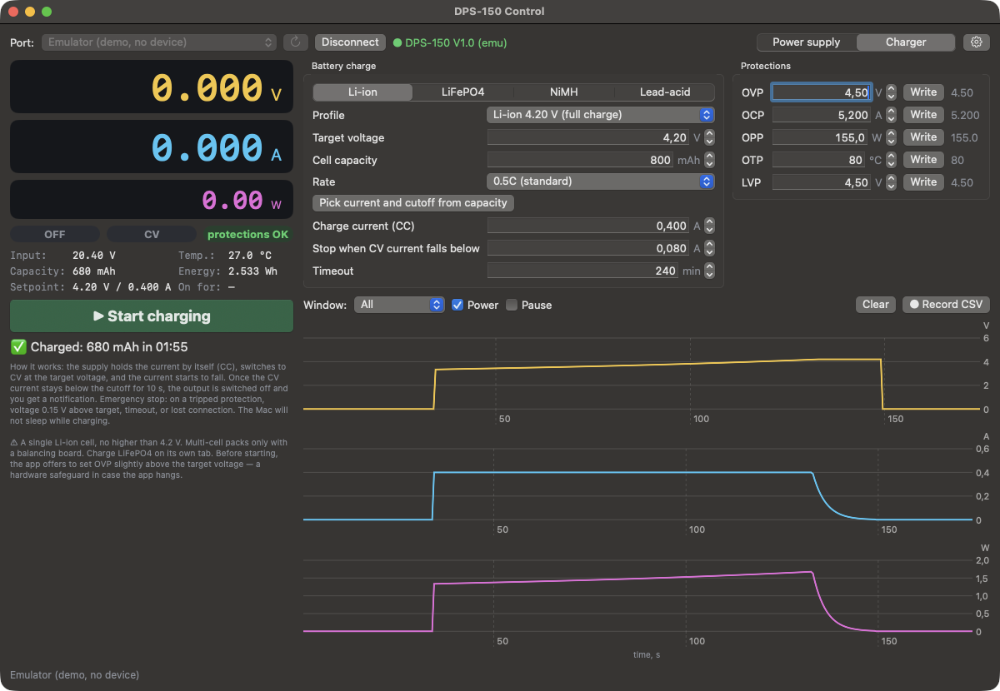
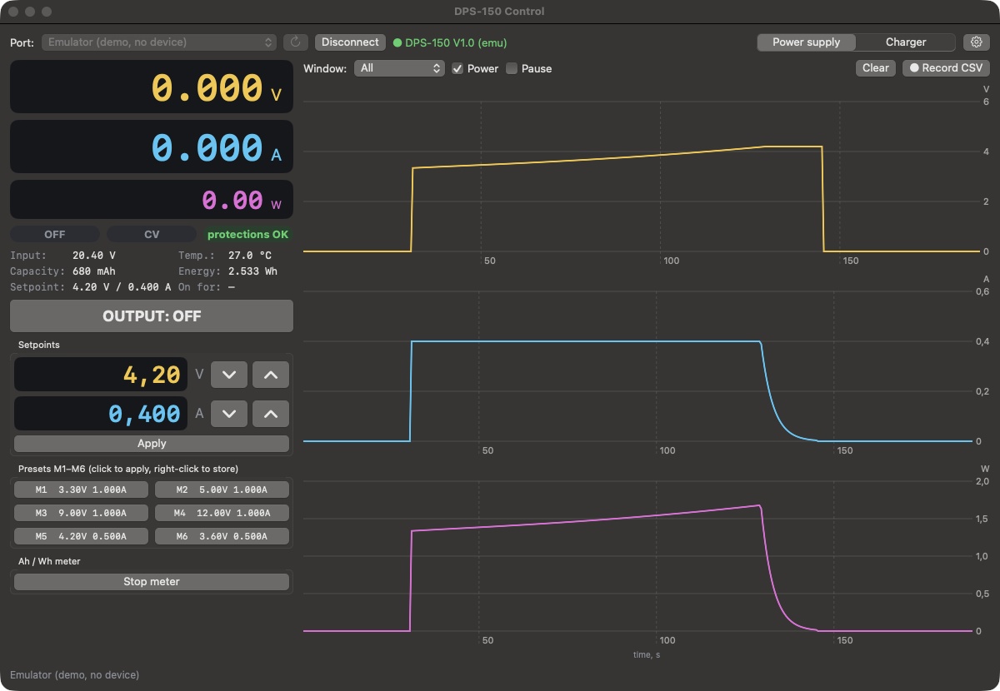
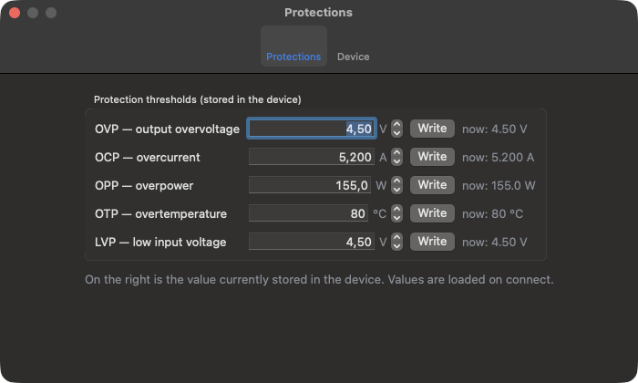

# DPS-150 Control

Нативное приложение для macOS для лабораторного блока питания **FNIRSI DPS-150**:
показания, уставки, пресеты, защиты, графики, запись в CSV и заряд аккумуляторов с
автоотключением — Li-ion, LiFePO4, NiMH и свинцовых 6/12 В.

SwiftUI, без сторонних зависимостей, macOS 14+. Интерфейс на русском и английском
([README in English](README.md)).



| Блок питания | Настройки |
| --- | --- |
|  |  |

> **Проект не связан с FNIRSI.** Протокол взят из реверс-инжиниринга
> [cho45/fnirsi-dps-150](https://github.com/cho45/fnirsi-dps-150) и описан в
> [docs/PROTOCOL.md](docs/PROTOCOL.md).

## Установка

- **Mac App Store** — после одобрения первого релиза.
- **GitHub Releases** — скачайте `DPS-150-Control-x.y.z.zip` со страницы
  [Releases](../../releases) и перенесите приложение в `/Applications`. Эта сборка
  при запуске (и по «Проверить обновления…») проверяет новый релиз на GitHub,
  показывает описание релиза и умеет сама скачать и установить обновление. Это один
  запрос к `api.github.com` за запуск, больше ничего не отправляется.
- **Из исходников** — см. ниже.

## Подключение

Подключите DPS-150 кабелем к **micro-USB порту данных** (Type-C у него только для
питания). Порт появится как `/dev/cu.usbmodem…`, в списке он помечен ★. Драйвер не
нужен.

Нет прибора под рукой? Выберите в списке портов **«Эмулятор (демо, без прибора)»**:
он изображает блок с Li-ion банкой на выходе (время ускорено в 60 раз), так что
можно попробовать всё, включая полный заряд.

## Что умеет

- **Два режима:** «Блок питания» и «Зарядник» — переключатель в верхней панели.
- **Показания:** крупные V / A / W, режим CC/CV, состояние защит, входное
  напряжение, температура, время работы выхода.
- **Уставки:** крупные V и I с кнопками ▼▲ (шаг 0.1, с ⌥ — 0.01, удержание —
  автоповтор) или ввод с клавиатуры и Enter. Если крутите ручку на самом приборе,
  значения в окне обновляются сами.
- **Выход:** кнопка или ⌘↩.
- **Пресеты M1–M6:** клик применяет пресет, правый клик записывает в ячейку текущие уставки.
- **Счётчик Ah/Wh:** встроенный в прибор, его можно включать и выключать.
- **График:** V, I и P с окном от 30 с до «всё». Пауза, очистка, экспорт (⌘S) и
  непрерывная запись в CSV.
- **Заряд АКБ:**
  - вкладка на каждую химию со своими профилями, токами, порогом и предупреждениями:
    Li-ion (4.20 / 4.10 / 3.80 В), LiFePO4 (3.60 / 3.45 В), свинцовые (6 В, 12 В,
    12 В гелевый) и NiMH (1–12 банок);
  - подбор тока и порога окончания по ёмкости;
  - Li-ion, LiFePO4, свинцовые: CC/CV, выход выключается, когда в режиме CV ток
    10 с держится ниже порога;
  - NiMH: стандартный медленный заряд 0.1C, стоп на 150 % ёмкости или по таймеру
    (быстрого заряда с −ΔV нет);
  - свинцовые и NiMH — **экспериментально**: проверено только на эмуляторе, см.
    [Что проверено](#что-проверено);
  - аварийный стоп при срабатывании защиты, при превышении цели на 0.15 В, по
    таймауту, при потере связи и если ток так и не пошёл;
  - перед стартом предлагает выставить OVP и OCP чуть выше конечного напряжения и
    тока заряда как аппаратную страховку, а при возврате в режим блока питания —
    вернуть прежние значения;
  - по окончании приходит уведомление macOS со звуком; на время заряда Mac не засыпает.
- **Защиты:** OVP, OCP, OPP, OTP и LVP — чтение и запись; на экране зарядника и в
  настройках (⌘,).
- **Прибор** (в настройках): модель и версии, пределы выхода, яркость и громкость.

## ⚠ Безопасность

Приложение управляет питанием, к которому могут быть подключены литиевые банки.
Остановка заряда — **программная**: если приложение или Mac зависнет, банку защищают
только OVP/OCP самого прибора, поэтому выставляйте их перед зарядом. Проверяйте
вкладку химии и профиль (с чужим профилем батарея перезарядится), не оставляйте
заряд без присмотра. Заряд свинцовых и NiMH пока проверен только на эмуляторе.
Вы используете приложение на свой риск, гарантий нет (см. лицензию).

## Что проверено

| Что | Статус |
| --- | --- |
| Подключение, показания, уставки, запись OVP | Проверено на реальном DPS-150 (прошивка V1.2) |
| Заряд Li-ion | Полный цикл проверен на реальном DPS-150 с настоящей банкой |
| Заряд LiFePO4 | Тот же алгоритм CC/CV, что и у Li-ion; проверен только на эмуляторе |
| **Заряд свинцовых** | **Только эмулятор — на реальном аккумуляторе не тестировалось** |
| **Заряд NiMH** | **Только эмулятор — на реальном аккумуляторе не тестировалось** |

Эмулятор изображает одну Li-ion банку. Для свинцовых и NiMH это значит, что
проверены только интерфейс и логика остановки (лимит по ёмкости, таймер, аварийные
стопы), но не поведение настоящего аккумулятора этой химии. Напряжения, токи и
пороги для этих двух химий взяты из общих рекомендаций по заряду и на практике не
подтверждены. Если пробуете на реальном аккумуляторе — будьте рядом весь заряд,
сверьтесь с его документацией и, пожалуйста, напишите о результате в issue.

## Сборка из исходников

Нужны macOS 14+ и Xcode или Command Line Tools.

```bash
swift run DPS150Control --demo   # с эмулятором
swift run DPS150Control          # с реальным прибором
swift test                       # ~25 с: протокол, клиент и заряд против эмулятора
./build_app.sh --install         # dist/DPS-150 Control.app → /Applications
```

`swift run` всегда показывает русский интерфейс; переводы работают только в
собранном `.app`.

`SANDBOX=1 ./build_app.sh` собирает такую же сборку в песочнице, какая уходит в
App Store, — удобно проверить, что в песочнице всё работает.

## Структура

```
Sources/DPS150Kit/Protocol.swift   кадры, регистры, инкрементальный разбор, DeviceState
Sources/DPS150Kit/Device.swift     клиент: поток чтения + очередь записи
Sources/DPS150Kit/Fake.swift       эмулятор DPS-150 с моделью Li-ion банки (демо и тесты)
Sources/DPS150Kit/Charge.swift     CC/CV-заряд с автостопом
Sources/DPS150Control/             приложение: Model.swift (состояние), Views.swift (интерфейс)
Resources/*.lproj                  локализации (ключ — русская строка из исходников)
Tests/                             протокол, клиент и заряд против эмулятора
docs/PROTOCOL.md                   описание протокола
```

## Если что-то не так

- **«Нет данных от прибора».** Проверьте, что кабель подключён к micro-USB, а не к
  Type-C питания, и что порт не занят другой программой (`lsof | grep usbmodem`).
- **Заряд не начинается, показан LVP.** На Type-C нет питания, и прибор запитан от
  банки на выходе.
- **Собранное приложение не открывается.** Запустите
  `dist/DPS-150\ Control.app/Contents/MacOS/DPS-150\ Control` из терминала —
  там будет видна ошибка.

## Участие

Issues и pull request'ы приветствуются; по остальным вопросам пишите на dev@pazyuk.com. Изменения в `ChargeController` и в логике
выхода проверяйте в `--demo` и `swift test`; аварийные стопы ослаблять нельзя.
Каждую новую строку интерфейса добавляйте в `Resources/en.lproj/Localizable.strings`.

## Лицензия

© 2026 Alexey Pazyuk <dev@pazyuk.com>. GNU General Public License версии 3 или (на ваш выбор) более
поздней — см. [LICENSE](LICENSE). Программа распространяется БЕЗ КАКИХ-ЛИБО ГАРАНТИЙ.
